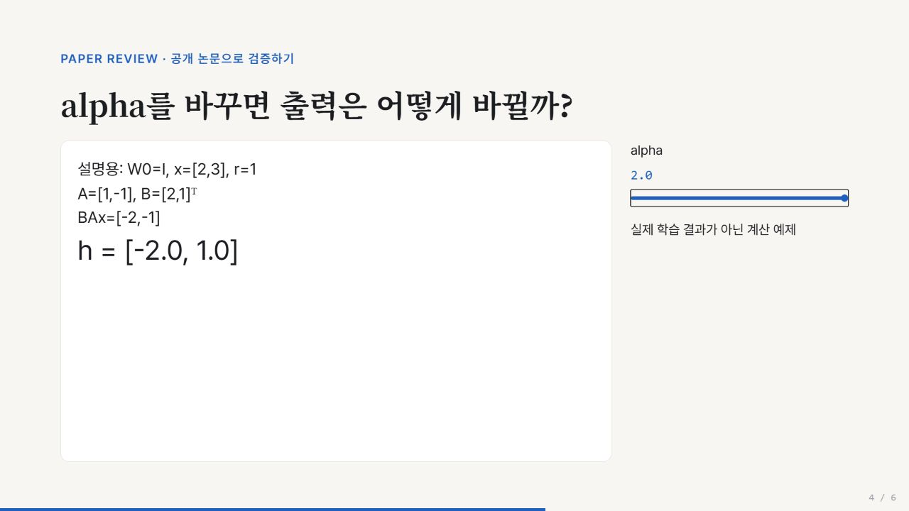

# Paper Review Kit

논문을 읽는 지침 5개와 로컬 Python 도구. **자동 논문 검색·자동 과학 검증·학습 성능 재현 프로그램이 아닙니다.** AI 에이전트가 원문을 읽고 근거 기록을 작성하며, 도구는 반복 검사와 출력을 담당합니다.



## 구성

| 구성 | 역할 |
|---|---|
| paper-review | 범위·깊이·출력 조율 |
| literature-map | 인용 추적·자료 선정 지침 |
| paper-explain | 배경·수식·시각 설명 지침 |
| evidence-check | 주장과 원문을 대조하는 지침 |
| research-connect | 관계·검증 가능한 가설 지침 |
| reviewkit.py | PDF 추출, JSON 구조·ID 검사, DOI 중복 후보, 출력, 상태 관리 |
| hooks/review_hook.py | 선택적으로 연결할 읽기 전용 상태·검사 어댑터 |

## 실행

Python 3.10 이상. 저장소 루트에서 실행합니다.

```sh
python -m venv .venv
# Windows: .venv\Scripts\activate
# macOS/Linux: source .venv/bin/activate
python -m pip install -r requirements.txt
python -m unittest discover -s tests -v
python examples/lora/verify_math.py
python reviewkit.py check examples/lora
python reviewkit.py export examples/lora --format html obsidian graph --force
python build_slides.py
python -m http.server 8768 --bind 127.0.0.1
```

브라우저에서 `http://127.0.0.1:8768/examples/lora/exports/review.html` 또는 `slides.html`을 엽니다. 정적 HTML은 다운로드해서 직접 열어도 됩니다. 스크립트는 신뢰하는 로컬 원고만 입력으로 사용합니다. Markdown의 HTML과 demo.html은 실행 가능한 저작 콘텐츠이므로 외부 파일을 검토 없이 렌더링하지 않습니다.

슬라이드: 방향키 이동, F 전체화면, S 발표자 보기, Esc 입력 컨트롤 벗어나기. 공개 예제 6장에는 수식 조작 데모 1개가 있습니다. `build_slides.py`는 LoRA 전용 제작 예제입니다. 임의 논문의 슬라이드를 자동 생성하지 않습니다.

## 새 논문에 사용하기

1. `skills/`의 다섯 폴더를 에이전트가 사용하는 스킬 경로에 함께 설치합니다. `python install_skills.py --destination <skills-directory>`를 사용할 수 있습니다. 기존 폴더가 있으면 덮어쓰지 않습니다.
2. 공개 PDF와 질문을 에이전트에 주고 `$paper-review`로 요청합니다. 이 저장소 경로와 원하는 결과 형식을 함께 지정합니다.
3. 에이전트가 `schema.json`에 맞는 evidence.json과 `[claim:C1]` 같은 참조를 가진 review.md를 작성합니다. 빈 양식을 자동으로 사실로 채우는 기능은 없습니다.
4. PDF는 `python reviewkit.py extract input.pdf output.pages.json`으로 추출합니다. OCR과 원본 그림 추출 기능은 없으므로 수식·표는 별도로 확인합니다.
5. `check`로 구조를 검사하고 실제 원문과 주장을 대조합니다. `export --format html`, `obsidian`, `graph` 중 필요한 것만 선택합니다.

```text
$paper-review
이 공개 논문의 핵심 방법을 처음 접하는 독자에게 설명해줘.
원문 주장·내 해석·가설을 나누고 근거 위치를 남겨줘.
핵심 수식은 작은 계산 예로 확인하고, 관련 논문과 연결해줘.
이 저장소의 schema.json과 reviewkit.py를 사용해서
Markdown과 HTML로 저장하고 실행하지 않은 실험을 표시해줘.
```

## 재개와 훅

```sh
python reviewkit.py mark examples/lora review review.md evidence.json
python reviewkit.py resume examples/lora
python hooks/review_hook.py examples/lora resume
python hooks/review_hook.py examples/lora check
```

입력 내용이 바뀌면 이전 done 상태를 stale로 읽습니다. mark는 파일 존재를 확인할 뿐 내용 검토를 대신하지 않습니다. 재개는 상태 요약이며 AI 작업을 자동 실행하지 않습니다. 훅 어댑터는 수동 호출로 검증했습니다. 특정 제품의 세션 훅으로 자동 등록하거나 실제 세션 이벤트로 검증하지 않았습니다. 호스트별 설정·JSON 응답 규격은 해당 제품 문서에 맞춰 연결해야 합니다.

## 검증 범위

[검증 기록](docs/verification.md)을 확인하세요. LoRA v2 PDF 26쪽 텍스트 추출, 핵심 방법 4–5쪽 시각 대조, 주장 5개 연결, 설명용 계산 네 조건, 후속 QLoRA 초록 연결, HTML·6장 덱을 사용했습니다. 본 논문의 모든 실험·부록 재현이나 독립 사용자 평가가 아닙니다. Google Scholar·Deep Research는 이번 실행에 사용하지 않았습니다. PDF와 추출 전문은 재배포하지 않습니다.

## 라이선스

직접 작성한 코드·지침은 MIT입니다. 슬라이드 기반 템플릿의 별도 MIT 고지는 `assets/LICENSE-frontend-slides`에 있습니다. 논문 원문 및 외부 자료의 권리는 각각의 저작자에게 있습니다.
